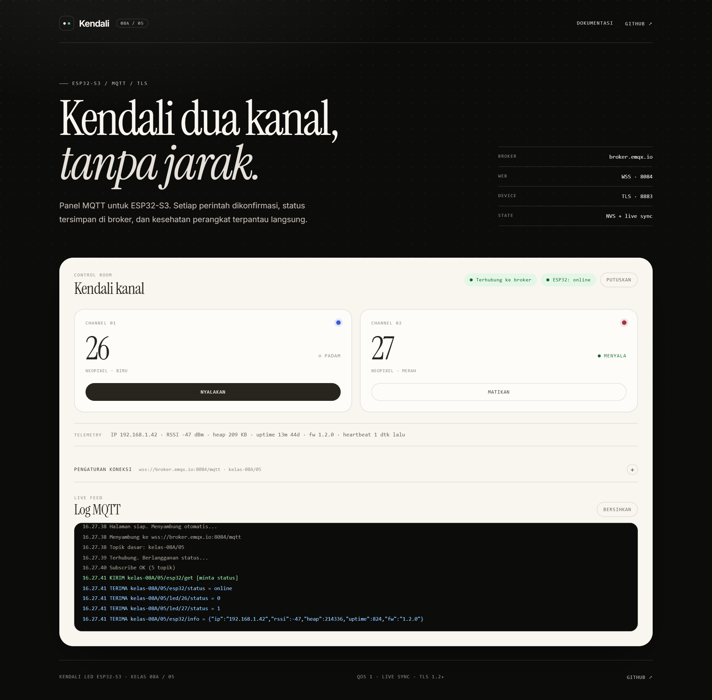

# Kendali — ESP32-S3 MQTT

Dashboard web + firmware ESP32-S3 untuk mengendalikan dua kanal LED lewat MQTT.
Tampilan dibuat ulang dengan arah visual editorial: latar gelap, headline serif,
label mono, dan permukaan kontrol berwarna krem.

**Live demo:** <https://jefryprr.github.io/esp32-mqtt-led-dashboard/>



## Isi folder

| File | Keterangan |
|---|---|
| `index.html` | Dashboard kontrol, status, telemetry, dan log MQTT |
| `mqtt.min.js` | Pustaka MQTT browser (lokal, tetap jalan tanpa CDN) |
| `favicon.svg` | Ikon halaman |
| `preview.png` | Gambar preview untuk README |
| `mqtt-diag/mqtt-diag.ino` | Firmware ESP32-S3 (TLS 8883, NeoPixel, NVS, LWT) |
| `mqtt-diag/secrets.example.h` | Contoh kredensial WiFi |
| `mqtt-diag/secrets.h` | Kredensial lokal Anda (di-ignore, tidak ikut repo) |

## Skema topik

Default `TOPIC_BASE = "kelas-08A/05"` dan harus sama di dashboard.

| Topik | Arah | Payload | Retain |
|---|---|---|---|
| `<base>/led/26/set` | web -> ESP | `0` / `1` | ya |
| `<base>/led/27/set` | web -> ESP | `0` / `1` | ya |
| `<base>/led/26/status` | ESP -> web | `0` / `1` | ya |
| `<base>/led/27/status` | ESP -> web | `0` / `1` | ya |
| `<base>/esp32/status` | ESP -> web | `online` / `offline` | ya + LWT |
| `<base>/esp32/info` | ESP -> web | JSON: ip, rssi, heap, uptime, fw | ya |
| `<base>/esp32/heartbeat` | ESP -> web | JSON: uptime, rssi, heap, s26, s27 | tidak |
| `<base>/esp32/get` | web -> ESP | `1` | tidak |

Retained message di broker publik bersifat **best-effort**. Dashboard tidak
bergantung padanya: setelah terhubung, dashboard mengirim `esp32/get` dan
firmware langsung membalas snapshot. Heartbeat juga membawa state LED, jadi
tampilan tetap sinkron meskipun broker tidak menyimpan retained message.

NeoPixel onboard: kanal 26 saja = biru, kanal 27 saja = merah, keduanya = hijau.

## Menjalankan firmware

Kebutuhan:

- ESP32 Arduino core **3.x** (diuji dengan 3.3.12) karena memakai `rgbLedWrite()`.
- Library **PubSubClient 2.8**.
- Board ESP32-S3 yang punya NeoPixel onboard (mis. ESP32-S3 DevKitC-1).

Langkah:

1. Salin `mqtt-diag/secrets.example.h` menjadi `mqtt-diag/secrets.h`.
2. Isi `WIFI_SSID` dan `WIFI_PASS` di `secrets.h`.
3. Buka `mqtt-diag/mqtt-diag.ino` di Arduino IDE.
4. Pilih board ESP32-S3 yang sesuai, lalu upload.
5. Buka Serial Monitor **115200 baud**. Log yang diharapkan:
   - `[WIFI] Terhubung | IP=...`
   - `[MQTTS] Terhubung`
   - `[PUBLISH] .../led/26/status = 0 | OK`

Cek kompilasi dari terminal:

```powershell
arduino-cli compile --fqbn esp32:esp32:esp32s3 mqtt-diag
```

> `secrets.h` tidak disertakan di repository. Tanpa file itu, firmware tetap
> bisa dikompilasi memakai placeholder, tetapi tidak akan terhubung ke WiFi.

## Menjalankan dashboard

Buka live demo di atas, atau buka `index.html` langsung di browser.

- Broker default: `wss://broker.emqx.io:8084/mqtt`
- Topik dasar default: `kelas-08A/05`
- Dashboard menyimpan konfigurasi terakhir di `localStorage`.
- Tombol baru aktif setelah ESP32 online dan status kanal diketahui.
- Setiap perintah memakai QoS 1 + retain, lalu menunggu konfirmasi status
  dari ESP32 (maksimal 6 detik).
- Saat halaman dibuka lewat HTTPS, broker wajib memakai `wss://` agar tidak
  diblokir browser. Ini sudah menjadi default.

## Deploy ke GitHub Pages

Site ini sudah disiapkan untuk GitHub Pages dari branch `main`, folder root:

1. Push repository ke GitHub.
2. Buka **Settings -> Pages**.
3. Pilih **Deploy from a branch**, branch `main`, folder `/ (root)`.
4. Tunggu build selesai, lalu buka `https://<username>.github.io/<repo>/`.

File `.nojekyll` disertakan agar seluruh aset statis disajikan apa adanya.
Semua aset web memakai path relatif, jadi tetap bekerja di subpath GitHub Pages.

## Perilaku penting

- **Sinkronisasi status**: setelah terhubung, dashboard mengirim
  `<base>/esp32/get`; firmware membalas status kedua kanal, info, dan heartbeat.
  Heartbeat tiap 15 detik juga membawa state LED (`s26`, `s27`), jadi tampilan
  tetap benar meskipun retained message tidak tersedia.
- **Retained command (best-effort)**: perintah terakhir dapat disimpan broker
  bila didukung. Firmware juga menyimpan state di NVS, sehingga kondisi LED
  tetap benar setelah reboot tanpa bergantung pada retained message.
- **State di NVS**: kondisi LED tersimpan di flash ESP32.
- **LWT + heartbeat**: `offline` dikirim broker saat koneksi putus; dashboard
  menandai "tidak merespons" bila heartbeat berhenti lebih dari 45 detik.
- **Reconnect**: WiFi dicek tiap 10 detik, MQTT tiap 5 detik.

## Broker lokal (opsional)

Dashboard bisa diarahkan ke Mosquitto lokal, misalnya `ws://192.168.1.10:9001`.
Firmware saat ini dikonfigurasi untuk EMQX TLS 8883. Untuk broker lokal, ubah:

- `MQTT_HOST` dan `MQTT_PORT` (mis. 1883),
- gunakan `WiFiClient` biasa, bukan `WiFiClientSecure`, atau pasang TLS di Mosquitto,
- pastikan topik dasar di dashboard sama.

Contoh listener Mosquitto untuk WebSocket:

```conf
listener 1883
allow_anonymous true

listener 9001
protocol websockets
```

Konfigurasi `allow_anonymous true` hanya untuk demo kelas, jangan untuk produksi.

## Troubleshooting

| Gejala | Periksa |
|---|---|
| Badge broker merah | URL/port broker, path EMQX harus `/mqtt`, halaman HTTPS wajib `wss://` |
| ESP32 tidak pernah online | Log Serial WiFi, NTP valid, handshake TLS, topik dasar |
| TLS gagal (`state=-2`) | Lihat baris `[TLS] error=...`; CA bisa berubah, verifikasi ulang |
| Status tidak muncul | `TOPIC_BASE` firmware harus sama dengan topik dasar dashboard |
| Tombol tidak aktif | ESP32 harus online dan status kanal sudah diterima |
| LED tidak berubah | Cek log MQTT; pastikan perintah `.../set` diterima ESP32 |

## Keamanan

- Kredensial WiFi disimpan di `secrets.h` dan tidak ikut repository.
- `broker.emqx.io` bersifat publik: siapa pun yang tahu topik bisa mengontrol LED.
  Live demo ini cocok untuk kelas, bukan untuk perangkat nyata yang sensitif.
- Untuk pemakaian nyata, gunakan broker privat + autentikasi, atau tambahkan
  akhiran acak pada `TOPIC_BASE` di kedua file.
